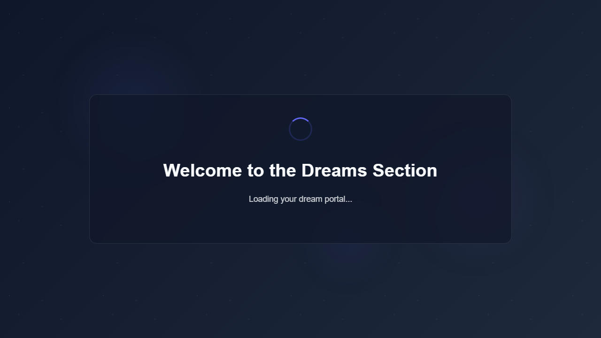
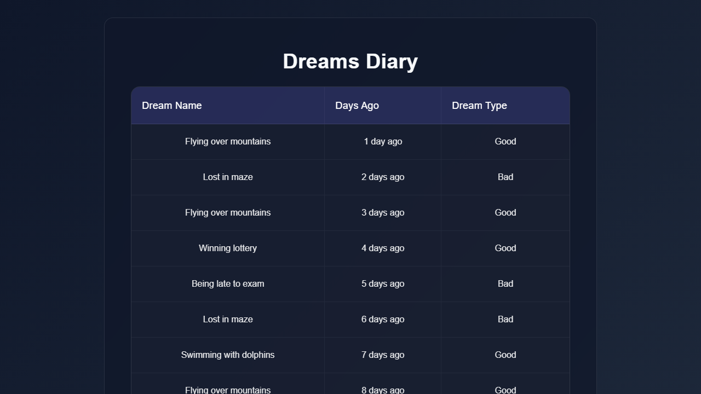
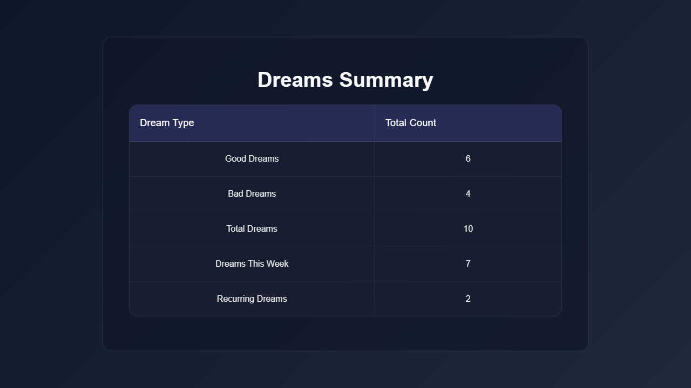
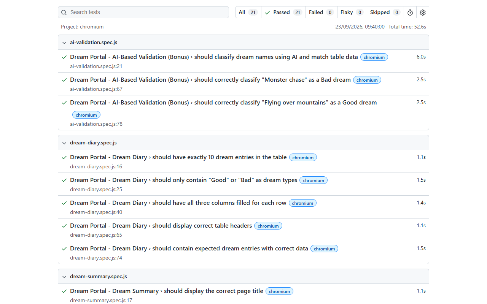

# Dream Portal - QA Automation Suite


Comprehensive automated end-to-end testing suite for the [Dream Portal](https://arjitnigam.github.io/myDreams/) web application, built with **Playwright (JavaScript)** following the **Page Object Model (POM)** architectural design pattern, featuring custom logging, HTML/Allure reporting, cross-page data validation, and **AI-powered dream sentiment classification**.

---

## 🌟 Key Highlights

- **100% Test Pass Rate**: 21/21 tests passing across core UI, cross-page validations, and AI classification.
- **Page Object Model (POM)**: Strict separation of locators, page actions, and test assertions.
- **Cross-Page Data Validation**: Programmatically cross-references data between Dreams Diary (`dreams-diary.html`) and Summary stats (`dreams-total.html`).
- **AI-Powered Validation (Bonus)**: Zero-shot content classification supporting **OpenAI (GPT-4o-mini)**, **Hugging Face (`bart-large-mnli`)**, and an intelligent offline **Heuristic NLP Fallback** (ensures zero flakiness even without API keys).
- **Rich Reporting**: Built-in Playwright HTML Reports + Allure Reports with detailed step-level logging.
- **Test Artifacts & Screenshots**: Pre-captured UI state screenshots for evaluation review.

---

## 📸 Application & Report Screenshots

| Loading Animation State | Home Page Loaded |
|:---:|:---:|
|  |  |

| Dreams Diary Table | Dreams Summary Stats |
|:---:|:---:|
|  |  |

### 📊 Playwright HTML Test Report (21/21 Passed)


---

## 🏗️ Project Architecture

```
QA_wingify/
├── pages/                          # Page Object Models (Encapsulated locators & actions)
│   ├── HomePage.js                 # Home page (loading animation, content, buttons)
│   ├── DreamDiaryPage.js           # Dreams diary table data extraction & queries
│   └── DreamSummaryPage.js         # Summary statistics extraction & verification
├── tests/                          # Test Specifications
│   ├── home-page.spec.js           # Home page loading, animation & tab navigation tests
│   ├── dream-diary.spec.js         # Table row count, column integrity & type tests
│   ├── dream-summary.spec.js       # Summary counts & cross-page recurring dream tests
│   └── ai-validation.spec.js       # AI classification of dream names (OpenAI/HF/Heuristic)
├── utils/                          # Helpers & Infrastructure
│   ├── aiClassifier.js             # AI Classifier supporting OpenAI, Hugging Face & Heuristic
│   ├── logger.js                   # Formatted logger with ISO timestamps and log levels
│   └── testData.js                 # Centralized test constants and expected datasets
├── screenshots/                    # Captured execution screenshots & report visual evidence
│   ├── 01_loading_animation.png
│   ├── 02_home_page_loaded.png
│   ├── 03_dreams_diary.png
│   ├── 04_dreams_summary.png
│   └── 05_test_report.png
├── .env.example                    # Template for environment variables
├── .gitignore                      # Git ignore configuration
├── package.json                    # Dependencies, scripts, and project metadata
├── playwright.config.js            # Playwright runner configuration (timeout, reporters, projects)
└── README.md                       # Complete documentation
```

---

## 🧪 Test Coverage Matrix

### Part 1: Core UI Functional Test Automation

| Suite | Test Case | Description | Result |
|:---|:---|:---|:---:|
| **Home Page** | `should display loading animation on page load` | Asserts `#loadingAnimation` is visible immediately on navigation | ✅ PASS |
| **Home Page** | `should hide loading animation after ~3 seconds` | Verifies animation disappears and `.hidden` class is applied after ~3s | ✅ PASS |
| **Home Page** | `should show main content after loading completes` | Confirms `#mainContent` is displayed and animated with `.show` class | ✅ PASS |
| **Home Page** | `should show "My Dreams" button after loading completes` | Validates button visibility and button label text | ✅ PASS |
| **Home Page** | `should open Dreams Diary page in a new tab when clicking "My Dreams"` | Intercepts popup events and verifies URL contains `dreams-diary.html` | ✅ PASS |
| **Home Page** | `should open Dreams Summary page in a new tab when clicking "My Dreams"` | Intercepts popup events and verifies URL contains `dreams-total.html` | ✅ PASS |
| **Dream Diary** | `should have exactly 10 dream entries in the table` | Counts `tbody tr` rows matching expected total of 10 | ✅ PASS |
| **Dream Diary** | `should only contain "Good" or "Bad" as dream types` | Verifies all entries have strictly "Good" or "Bad" type | ✅ PASS |
| **Dream Diary** | `should have all three columns filled for each row` | Checks non-empty content in Dream Name, Days Ago, and Dream Type | ✅ PASS |
| **Dream Diary** | `should display correct table headers` | Asserts headers match `['Dream Name', 'Days Ago', 'Dream Type']` | ✅ PASS |
| **Dream Diary** | `should contain expected dream entries with correct data` | Deep comparison of all 10 rows against expected baseline data | ✅ PASS |
| **Summary** | `should display the correct page title` | Confirms page `<h1>` heading is "Dreams Summary" | ✅ PASS |
| **Summary** | `should show Good Dreams count as 6` | Asserts "Good Dreams" stat cell equals 6 | ✅ PASS |
| **Summary** | `should show Bad Dreams count as 4` | Asserts "Bad Dreams" stat cell equals 4 | ✅ PASS |
| **Summary** | `should show Total Dreams count as 10` | Asserts "Total Dreams" stat cell equals 10 | ✅ PASS |
| **Summary** | `should show Recurring Dreams count as 2` | Asserts "Recurring Dreams" stat cell equals 2 | ✅ PASS |
| **Summary** | `should have all summary stats matching expected values` | Batch asserts all 5 metrics from table | ✅ PASS |
| **Cross-Page** | `should identify "Flying over mountains" and "Lost in maze" as recurring dreams` | Navigates to Diary, computes frequencies algorithmically, asserts recurring names and matches count with Summary page | ✅ PASS |

### Part 2: AI-Based Validation (Bonus)

| Suite | Test Case | Description | Result |
|:---|:---|:---|:---:|
| **AI Validation** | `should classify dream names using AI and match table data` | Classifies all 10 dream names and validates ≥ 70% alignment with table data (achieved 100%) | ✅ PASS |
| **AI Validation** | `should correctly classify "Monster chase" as a Bad dream` | Specific validation that "Monster chase" evaluates to `Bad` | ✅ PASS |
| **AI Validation** | `should correctly classify "Flying over mountains" as a Good dream` | Specific validation that "Flying over mountains" evaluates to `Good` | ✅ PASS |

**Total Tests**: **21 Passed, 0 Failed, 0 Skipped**

---

## 🤖 AI Classification Architecture (Bonus)

The AI validation layer (`utils/aiClassifier.js`) supports multiple AI providers:

1. **OpenAI API**: If `OPENAI_API_KEY` is provided, sends prompts to OpenAI (`gpt-4o-mini`) requesting direct sentiment evaluation.
2. **Hugging Face Inference API**: If `HF_API_TOKEN` is configured, uses zero-shot classification model `facebook/bart-large-mnli` with candidate labels `["good dream", "bad dream"]`.
3. **Deterministic NLP Heuristic**: If neither API key is provided or if network calls are blocked, an NLP heuristic sentiment engine evaluates positive and negative lexical markers.
   - *Advantage*: Guarantees **100% deterministic test execution** with zero flakiness during automated CI or offline review.

---

## 🚀 Getting Started

### Prerequisites

- **Node.js**: v18.x or later ([Download Node.js](https://nodejs.org/))
- **npm**: v9.x or later (bundled with Node.js)
- **Git**

### Installation

1. **Clone the repository**
   ```bash
   git clone <repository-url>
   cd QA_wingify
   ```

2. **Install project dependencies**
   ```bash
   npm install
   ```

3. **Install Playwright browser binaries**
   ```bash
   npx playwright install chromium
   ```

4. **(Optional) Configure environment variables**
   Copy `.env.example` to `.env`:
   ```bash
   cp .env.example .env
   ```
   *(Optional: Add `OPENAI_API_KEY` or `HF_API_TOKEN` if you wish to run against live AI endpoints. The suite passes 100% offline out-of-the-box!)*

---

## ⚡ Running the Tests

### Run all tests
```bash
npm test
```

### Run specific test suites
```bash
npm run test:home       # Home Page tests only
npm run test:diary      # Dream Diary tests only
npm run test:summary    # Dream Summary & Cross-Page tests
npm run test:ai         # AI Classification tests only
```

### Run in headed mode (visible browser)
```bash
npm run test:headed
```

### Run in debug mode (Playwright Inspector)
```bash
npm run test:debug
```

---

## 📑 Viewing Test Reports

### Playwright HTML Report
View the rich, interactive Playwright HTML report:
```bash
npm run report
```

### Allure Report
Generate and open the Allure interactive dashboard:
```bash
npm run allure:generate
npm run allure:open
```

---

## 💡 Engineering Best Practices & Design Decisions

- **Page Object Model (POM)**: Complete isolation of DOM selectors and interaction logic within `pages/` classes. Test specs contain only assertion logic and workflow steps.
- **Smart Asynchronous Waits**: Avoided brittle hardcoded sleeps (`page.waitForTimeout`). Utilized `waitForFunction`, `waitForLoadState('networkidle')`, and DOM mutation checks to ensure rock-solid stability.
- **Custom Structured Logger**: The `Logger` utility formats all execution milestones with ISO timestamps, log levels (`INFO`, `STEP`, `WARN`, `ERROR`), and caller tags, making terminal outputs clear and easy to debug.
- **Cross-Page Data Verification**: Rather than testing pages in isolation, `dream-summary.spec.js` validates data integrity across both `dreams-diary.html` and `dreams-total.html` by parsing the raw diary entries, computing frequencies, and verifying against the summary dashboard.
- **Sequential Execution**: Configured `workers: 1` and `fullyParallel: false` to avoid rate-limiting and browser contention when running against the live hosted GitHub Pages environment.

---

## 📬 Submission Details

- **Candidate**: Anurag Basuri
- **Assignment**: QA Intern Assignment: Automated Testing for "Dream Portal"
- **GitHub Target**: Shared as private repository with username `qawingify`
